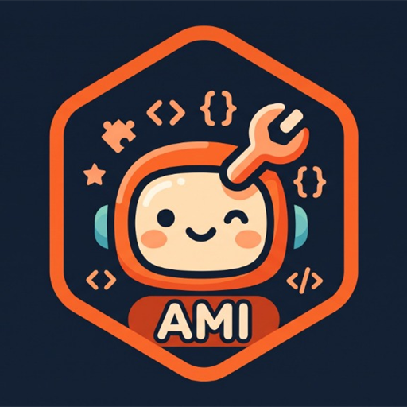
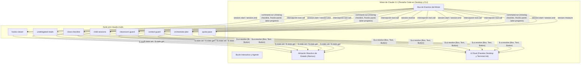

<p align="center">
  
</p>

# AMI Claude Mods

> **Mods de grado de producción, paneles UI reactivos y function hooks para Claude Desktop y la CLI de Claude Code.**

[English](README.md) | [Español](README.es.md)


---

## Descripción del Proyecto

`ami-claude-mods` es una suite curada de extensiones modulares (mods) y function hooks diseñados para la aplicación **Claude Desktop** (pestaña integrada de Code) y el motor de **Claude Code CLI**, integrada de forma sinérgica con el ecosistema de agentes **Amiga IA** (`amiga-ia`). A medida que los agentes autónomos de programación abordan flujos de trabajo de mayor complejidad, los desarrolladores enfrentan desafíos operativos: saturación de la ventana de contexto por búsquedas mecánicas, contenedores Docker huérfanos o procesos en segundo plano abandonados, commits accidentales con cuentas incorrectas de Git, mutaciones involuntarias en clústeres de Kubernetes de producción y falta de visibilidad sobre los hooks cargados.

Aunque se utilizan ampliamente en sesiones de terminal mediante la CLI, `ami-claude-mods` está diseñado como un complemento de primera clase para **Claude Desktop**—sirviendo como entorno de uso diario principal donde los paneles laterales (`Pane`), banners (`AbovePrompt`), medidores de estado y notificaciones toast se integran como controles nativos de la interfaz gráfica.

Este repositorio proporciona ocho plugins desacoplados, seguros para la privacidad y autocontenidos, orientados a maximizar la confiabilidad, visibilidad y seguridad sin necesidad de modificar los binarios base de Claude.

---

## Catálogo de Mods

| Mod | Tipos de Hook | Superficie Principal | Descripción |
| :--- | :--- | :--- | :--- |
| **[`hooks-viewer`](mods/hooks-viewer)** | `session.start`, `command.run`, `ui.render` | Panel Lateral (`Pane`) | Panel interactivo de inspección y comando `/hooks-panel` que lista todos los hooks configurados y mods cargados a través de las distintas capas de ajustes. |
| **[`undelegated-reads`](mods/undelegated-reads)** | `tool.call`, `prompt.submit`, `ui.render` | Barra de Estado y `AbovePrompt` | Indicador visual en tiempo real e interruptor de seguridad que contabiliza lecturas mecánicas consecutivas y fuerza la delegación en subagentes exploradores. |
| **[`close-checklist`](mods/close-checklist)** | `tool.call`, `session.end`, `command.run` | Panel Lateral y Toast | Inspector de seguridad previo a la salida que rastrea cambios pendientes en Git, contenedores/volúmenes Docker activos y procesos huérfanos mediante `/closing-checklist`. |
| **[`child-sessions`](mods/child-sessions)** | `session.receive`, `tool.call`, `ui.render` | Banda sobre el Prompt | Bandeja de mensajería entre agentes y sesiones que prioriza preguntas bloqueantes y ofrece botones de acción rápida para responder, visualizar o descartar. |
| **[`cleanroom-guard`](mods/cleanroom-guard)** | `tool.call` | Notificación Toast e Interceptor | Aislamiento estricto Cleanroom Doble Ciego para subagentes en flujos TDD, evitando la fuga de información de pruebas y el sesgo de confirmación. |
| **[`context-guard`](mods/context-guard)** | `tool.call`, `session.start`, `ui.render` | Barra de Estado y `AbovePrompt` | Guarda de seguridad multientorno que alinea la cuenta activa en GitHub CLI con el directorio de trabajo y bloquea comandos `kubectl` sin contexto en clústeres productivos. |
| **[`orchestrate-plan`](mods/orchestrate-plan)** | `tool.call`, `command.run`, `ui.render` | Panel Lateral, Barra de Estado y Toast | Panel en vivo con el avance del `plan.md` de una sesión orquestadora (`/plan-progress`), más la skill que mantiene el plan en el contrato que lee el panel y lanza las sesiones ejecutoras. |
| **[`quota-pace`](mods/quota-pace)** | `session.start`, `session.measure` | Barra de estado y Toast | Reparte el límite semanal de uso entre tus días laborales (20% por día de lunes a viernes por defecto) y avisa una vez al día cuando pasas la meta de hoy. |

---

## Estructura de Componentes y Arquitectura

Todos los plugins operan bajo el runtime aislado de módulos ECMAScript (ESM) compartido por **Claude Desktop** y **Claude Code CLI**. En lugar de importar librerías internas de Node.js directamente, los mods interactúan con el entorno anfitrión exclusivamente mediante la interfaz del motor `EngineInterface` (`$`), permitiendo que el estado reactivo y los componentes gráficos se sincronicen fluidamente entre paneles de escritorio y emuladores de terminal.



### Matriz de Responsabilidades

| Mod | Eventos Interceptados del Motor | Invariantes Preservados |
| :--- | :--- | :--- |
| `hooks-viewer` | `session.start`, `command.run` | Lectura inmutable de ajustes; no altera la ejecución de hooks. |
| `undelegated-reads` | `tool.call` (`Read`, `Grep`, `Glob`, shell) | Protege la ventana de contexto principal; no restringe subagentes. |
| `close-checklist` | `tool.call` (`Write`, `Edit`, shell, Docker, worktrees) | Auditoría de recursos sin bloquear el flujo normal de herramientas. |
| `child-sessions` | `session.receive`, `tool.call` (`SendMessage`) | Preserva encabezados de sobre; descarta destinatarios inalcanzables. |
| `cleanroom-guard` | `tool.call` (`Read`, `Write`, `Edit`, `Bash`, `PowerShell`) | Subagentes restringidos a su contrato; bucle principal inalterado. |
| `context-guard` | `tool.call` (`kubectl`, `git`), `session.start` | Previene mutaciones globales exigiendo el parámetro `--context`. |
| `orchestrate-plan` | `tool.call`, `command.run`, `ui.render` | Concilia las tareas de `plan.md` con sesiones activas y PRs fusionados sin mutar el archivo. |
| `quota-pace` | `session.start`, `session.measure` | Modela el ritmo de uso laboral contra la ventana de 7 días sin realizar peticiones de red. |

---

## Stack Tecnológico

- **Runtime:** Claude Desktop y Claude Code CLI (Early Access 2.1.x+)
- **Lenguaje:** TypeScript 5.4+ (ESNext, resolución Bundler)
- **Toolkit de UI:** UI de doble superficie (`Pane`, `AbovePrompt`, `StatusBar`, `Toast`) resuelta mediante `$.ui.resolve`
- **Gestor de Estado:** Átomos reactivos (`atom`, `read`, `update` de `'claude-code'`)
- **Framework de Pruebas:** Kit `'claude-code/testing'` (`claude plugin test`)

---

## Compilación y Ejecución

### Prerrequisitos

- Aplicación **Claude Desktop** (con la pestaña Code habilitada) o **Claude Code CLI** (`claude --version` >= 2.1.314)
- Node.js 22+ (para desarrollo, scripts de instalación y pruebas)
- Git 2.40+

### Instalación y Configuración

Puedes configurar los mods para que se carguen automáticamente en **Claude Desktop**, persistirlos en todas tus sesiones de terminal, ejecutarlos de forma puntual en la CLI, o instalar paquetes precompilados directamente desde GitHub Releases.

#### Método 1: Configuración en Claude Desktop (Flujo GUI Principal)

Claude Desktop carga plugins declarativamente desde tu archivo de configuración global:

1. **Sincronizar los mods en tu directorio local de Claude:**
   ```bash
   npm run install-mods
   ```
   Esto copiará los ocho mods a `~/.claude/mods/`.

2. **Configurar la persistencia en `~/.claude/settings.json`:**
   Añade la clave `CLAUDE_CODE_PLUGIN_DIRS` a tu archivo global de configuración:
   ```json
   {
     "CLAUDE_CODE_PLUGIN_DIRS": "~/.claude/mods/child-sessions:~/.claude/mods/cleanroom-guard:~/.claude/mods/close-checklist:~/.claude/mods/context-guard:~/.claude/mods/hooks-viewer:~/.claude/mods/orchestrate-plan:~/.claude/mods/quota-pace:~/.claude/mods/undelegated-reads"
   }
   ```
   *(En Windows, utiliza punto y coma `;` como separador de rutas, ej. `C:/ruta/a/.claude/mods/...`)*.

3. **Abrir Claude Desktop:** Cambia a la pestaña **Code**. Todos los mods se cargarán automáticamente con paneles laterales nativos, banners y medidores de estado.

#### Método 2: Configuración Persistente en CLI (Flujo Terminal)

- **Opción A (Ajustes Globales):** Si completaste el Método 1, Claude Code CLI detecta automáticamente el mismo `~/.claude/settings.json` y carga los mods en cada sesión de terminal.
- **Opción B (Perfil de Shell):** Exporta la variable directamente en tu perfil (`~/.bashrc`, `~/.zshrc` o `$PROFILE` en PowerShell):
  ```bash
  npm run install-mods -- --print-env
  ```
  Pega la línea exportada en tu perfil de shell.

#### Método 3: Parámetro Directo por Línea de Comandos (Prueba Rápida en CLI)

Carga uno o más mods directamente al iniciar una sesión puntual en la terminal:

```bash
claude --plugin-dir mods/hooks-viewer --plugin-dir mods/undelegated-reads
```

#### Método 4: Descarga Directa desde GitHub Releases (Sin Requerir Node.js)

1. Descarga el paquete comprimido desde [GitHub Releases](https://github.com/AnaCataVC/ami-claude-mods/releases) (ej. `ami-claude-mods-all-vX.Y.Z.zip` o archivos individuales por mod).
2. Descomprime el contenido en la carpeta que prefieras (ej. `~/.claude/mods/`).
3. Agrega la ruta a `~/.claude/settings.json` (para Desktop y CLI) o inicia Claude Code con `--plugin-dir`:
   ```bash
   claude --plugin-dir ~/.claude/mods/hooks-viewer
   ```

### Idioma de los Mods

Todos los mods muestran sus paneles, toasts, líneas de estado y descripciones de comandos en inglés por defecto. Para mostrarlos en español, define `CLAUDE_MODS_LANG` en el bloque `env` del `settings.json` de Claude Code:

```json
{
  "env": {
    "CLAUDE_MODS_LANG": "es"
  }
}
```

Solo el valor exacto `es` (sin importar mayúsculas ni espacios alrededor) activa el español; cualquier otro valor, o la variable sin definir, usa inglés. El valor se lee al iniciar la sesión. No cambia:

- los nombres de los comandos (`/closing-checklist`, `/hooks-panel`, `/plan-progress`);
- los textos dirigidos al modelo, como los motivos de bloqueo;
- las palabras que `orchestrate-plan` lee del `plan.md` (`Estado`, `pendiente`, `hecho`...). En inglés el panel traduce los estados que muestra, pero en el archivo se siguen escribiendo en español.
### Verificación de Mods Cargados

Una vez iniciado Claude Desktop o Claude Code, confirma que los mods están operando:

1. Ejecuta `/hooks-panel` para abrir el panel lateral interactivo de **`hooks-viewer`** con la lista de plugins, hooks y capas de configuración activas.
2. Ejecuta `/closing-checklist` para activar **`close-checklist`** e inspeccionar cambios pendientes de Git, contenedores Docker y tareas en segundo plano antes de cerrar tu jornada.
3. Observa los indicadores de estado: **`undelegated-reads`** y **`context-guard`** mostrarán en tiempo real el medidor de lecturas y el perfil de entorno activo.

### Validación de Mods

Valida los esquemas de manifiesto (`plugin.json`), contratos de hooks (`hooks.json`) y definiciones de estado atómico de todos los plugins:

```bash
# Validar todos los mods del repositorio
npm run validate

# O validar un mod individual
claude plugin validate mods/hooks-viewer
```

---

## Pruebas Automatizadas y Calidad

Todos los mods incorporan suites de pruebas automatizadas ejecutadas contra el motor headless de pruebas de `'claude-code/testing'`:

```bash
# Ejecutar todas las pruebas en secuencia
npm test

# Ejecutar pruebas para un mod específico
claude plugin test mods/hooks-viewer
```

Para activar los hooks locales de Git previo al push:
```bash
npm run prepare
```

> [!NOTE]
> La verificación se declara exitosa cuando el conjunto completo de pruebas automatizadas finaliza con un 100% de éxito y cero regresiones.

Para consultar el desglose completo de pipelines CI/CD, publicación de releases y hooks de Git, revisa [docs/automations.es.md](docs/automations.es.md). Para conocer cómo se versionan los releases (el repositorio permanece en 0.x), consulta [docs/versioning-policy.md](docs/versioning-policy.md).

---

## Decisiones de Arquitectura y Aprendizajes

Para un desglose en profundidad de las restricciones técnicas, errores prevenidos del motor y reglas de empaquetado, consulta la base de conocimiento dedicada en [docs/learning/](docs/learning/README.es.md).

1. **Aislamiento Controlado por el Anfitrión frente a Runtime Node.js:** Los plugins de Claude Code no se ejecutan dentro de un proceso Node.js libre. Operan en un contenedor ESM aislado sin acceso directo a `require()` o llamadas arbitrarias a `fs`. Toda entrada y salida fluye por el manejador del motor `$` (`$.fs`, `$.process`, `$.settings`), lo que garantiza seguridad y un comportamiento homogéneo entre Windows, macOS y Linux.
2. **Alcance de Nivel Superior para la Referencia del Motor (`$`):** El análisis estático del validador de plugins exige estrictamente que la instancia `$` no sea transferida a funciones anónimas o internas declaradas dentro del cierre de `register`. Las funciones auxiliares que manipulen `$` deben declararse en el alcance superior del módulo (`async function helper($: Engine) { ... }`).
3. **Sinergia con Cleanroom Doble Ciego:** El desarrollo guiado por pruebas (TDD) con agentes de IA presenta sesgo de confirmación cuando los generadores de tests inspeccionan la implementación en código de producción. Al implementar `cleanroom-guard`, desacoplamos al constructor (`ami-cleanroom-builder`) del autor de pruebas (`ami-cleanroom-tester`), logrando una integración nativa con la skill `ami-orchestrate-cleanroom` de Amiga IA.
4. **Registro Declarativo de Estado en Contratos TypeScript:** Cada clave atómica administrada por un plugin (`atom({ plugin, key })`) debe declararse formalmente en `types/index.d.ts` extendiendo la interfaz `PluginState`. Omitir estas declaraciones genera errores inmediatos en el validador, previniendo colisiones de estado no tipadas entre distintos plugins concurrentes.
5. **Guardas Configurables para Entornos de Trabajo Multicuentas:** Incluir nombres de usuario o rutas absolutas fijas destruye la portabilidad de un repositorio público. Al desacoplar `context-guard` mediante un esquema declarativo JSON (`context-guard.json`), los desarrolladores pueden mapear carpetas corporativas y personales, evitar mutaciones con `kubectl` huérfanos y prevenir commits indeseados entre diferentes perfiles de GitHub.
6. **Paridad de Entorno Dual (GUI Desktop y Terminal CLI):** El motor de Claude resuelve los componentes visuales mediante `$.ui.resolve`, asegurando que los plugins funcionen de manera idéntica en Claude Desktop y en la CLI de terminal. En Claude Desktop, paneles como `hooks-viewer` se despliegan como cajones laterales interactivos mientras que métricas y avisos se sitúan justo sobre el prompt y la barra inferior. La persistencia centralizada en `~/.claude/settings.json` garantiza que las sesiones de escritorio y de terminal compartan automáticamente los mods activos.

---

## Licencia

Este proyecto está bajo la Licencia MIT. Consulta el archivo [LICENSE](LICENSE) para más detalles.
