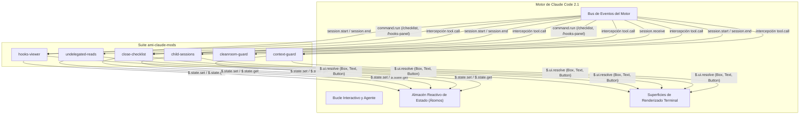

<p align="center">
  
</p>

# AMI Claude Mods

> **Mods de grado de producción, paneles UI reactivos y function hooks para la CLI de Claude Code.**

[English](README.md) | [Español](README.es.md)


---

## Descripción del Proyecto

`ami-claude-mods` es una suite curada de extensiones modulares (mods) y function hooks diseñados para el motor de **Claude Code CLI**, integrada de forma sinérgica con el ecosistema de agentes **Amiga IA** (`amiga-ia`). A medida que los agentes autónomos de programación abordan flujos de trabajo de mayor complejidad, los desarrolladores enfrentan desafíos operativos: saturación de la ventana de contexto por búsquedas mecánicas, contenedores Docker huérfanos o procesos en segundo plano abandonados, commits accidentales con cuentas incorrectas de Git, mutaciones involuntarias en clústeres de Kubernetes de producción y falta de visibilidad sobre los hooks cargados.

Este repositorio proporciona seis plugins desacoplados, seguros para la privacidad y autocontenidos, orientados a maximizar la confiabilidad, visibilidad y seguridad sin necesidad de modificar los binarios base de Claude Code.

---

## Catálogo de Mods

| Mod | Tipos de Hook | Superficie Principal | Descripción |
| :--- | :--- | :--- | :--- |
| **[`hooks-viewer`](mods/hooks-viewer)** | `session.start`, `command.run`, `ui.render` | Panel Lateral (`Pane`) | Panel interactivo de inspección y comando `/hooks-panel` que lista todos los hooks configurados y mods cargados a través de las distintas capas de ajustes. |
| **[`undelegated-reads`](mods/undelegated-reads)** | `tool.call`, `prompt.submit`, `ui.render` | Barra de Estado y `AbovePrompt` | Indicador visual en tiempo real e interruptor de seguridad que contabiliza lecturas mecánicas consecutivas y fuerza la delegación en subagentes exploradores. |
| **[`close-checklist`](mods/close-checklist)** | `tool.call`, `session.end`, `command.run` | Panel Lateral y Toast | Inspector de seguridad previo a la salida que rastrea cambios pendientes en Git, contenedores/volúmenes Docker activos y procesos huérfanos mediante `/checklist` (o `/cierre`). |
| **[`child-sessions`](mods/child-sessions)** | `session.receive`, `tool.call`, `ui.render` | Banda sobre el Prompt | Bandeja de mensajería entre agentes y sesiones que prioriza preguntas bloqueantes y ofrece botones de acción rápida para responder, visualizar o descartar. |
| **[`cleanroom-guard`](mods/cleanroom-guard)** | `tool.call` | Notificación Toast e Interceptor | Aislamiento estricto Cleanroom Doble Ciego para subagentes en flujos TDD, evitando la fuga de información de pruebas y el sesgo de confirmación. |
| **[`context-guard`](mods/context-guard)** | `tool.call`, `session.start`, `ui.render` | Barra de Estado y `AbovePrompt` | Guarda de seguridad multientorno que alinea la cuenta activa en GitHub CLI con el directorio de trabajo y bloquea comandos `kubectl` sin contexto en clústeres productivos. |

---

## Estructura de Componentes y Arquitectura

Todos los plugins operan bajo el runtime aislado de módulos ECMAScript (ESM) de Claude Code. En lugar de importar librerías internas de Node.js directamente, los mods interactúan con el entorno anfitrión exclusivamente mediante la interfaz del motor `EngineInterface` (`$`).



### Matriz de Responsabilidades

| Mod | Eventos Interceptados del Motor | Invariantes Preservados |
| :--- | :--- | :--- |
| `hooks-viewer` | `session.start`, `command.run` | Lectura inmutable de ajustes; no altera la ejecución de hooks. |
| `undelegated-reads` | `tool.call` (`Read`, `Grep`, `Glob`, shell) | Protege la ventana de contexto principal; no restringe subagentes. |
| `close-checklist` | `tool.call` (`Write`, `Edit`, shell, Docker, worktrees) | Auditoría de recursos sin bloquear el flujo normal de herramientas. |
| `child-sessions` | `session.receive`, `tool.call` (`SendMessage`) | Preserva encabezados de sobre; descarta destinatarios inalcanzables. |
| `cleanroom-guard` | `tool.call` (`Read`, `Write`, `Edit`, `Bash`, `PowerShell`) | Subagentes restringidos a su contrato; bucle principal inalterado. |
| `context-guard` | `tool.call` (`kubectl`, `git`), `session.start` | Previene mutaciones globales exigiendo el parámetro `--context`. |

---

## Stack Tecnológico

- **Runtime:** Claude Code CLI (Early Access 2.1.x)
- **Lenguaje:** TypeScript 5.4+ (ESNext, resolución Bundler)
- **Toolkit de UI:** Terminal React/Ink JSX nativo (globales `h` y `Fragment` resueltos mediante `$.ui.resolve`)
- **Gestor de Estado:** Átomos reactivos (`atom`, `read`, `update` de `'claude-code'`)
- **Framework de Pruebas:** Kit `'claude-code/testing'` (`claude plugin test`)

---

## Compilación y Ejecución

### Prerrequisitos

- Claude Code CLI instalado (`claude --version` >= 2.1.314)
- Node.js 20+ (para utilidades locales de desarrollo)
- Git 2.40+

### Instalación

Los mods pueden cargarse directamente utilizando el parámetro `--plugin-dir`, mediante la variable de entorno `CLAUDE_CODE_PLUGIN_DIRS` o copiando los plugins requeridos en tu directorio personal de Claude (`~/.claude/mods`).

#### Método A: Parámetro Directo por Línea de Comandos (Recomendado)

```bash
claude --plugin-dir mods/hooks-viewer --plugin-dir mods/undelegated-reads
```

#### Método B: Carga mediante Variable de Entorno

En PowerShell:
```powershell
$env:CLAUDE_CODE_PLUGIN_DIRS = "C:/ruta/a/ami-claude-mods/mods/hooks-viewer;C:/ruta/a/ami-claude-mods/mods/undelegated-reads"
claude
```

En Bash:
```bash
export CLAUDE_CODE_PLUGIN_DIRS="/ruta/a/ami-claude-mods/mods/hooks-viewer:/ruta/a/ami-claude-mods/mods/undelegated-reads"
claude
```

#### Método C: Sincronización Automatizada a la Carpeta Local

```bash
# Sincronizar todos los mods en ~/.claude/mods/
npm run install-mods

# O imprimir la declaración exacta de variables de entorno para tu terminal:
npm run install-mods -- --print-env
```

### Validación de Mods

Valida los esquemas de manifiesto (`plugin.json`), contratos de hooks (`hooks.json`) y definiciones de estado atómico de todos los plugins:

```bash
# Validar todos los mods del repositorio
npm run validate

# O validar un mod individual
claude plugin validate mods/hooks-viewer
```

---

## Pruebas Automatizadas y Calidad

Todos los mods incorporan suites de pruebas automatizadas ejecutadas contra el motor headless de pruebas de `'claude-code/testing'`:

```bash
# Ejecutar todas las pruebas en secuencia
npm test

# Ejecutar pruebas para un mod específico
claude plugin test mods/hooks-viewer
```

Para activar los hooks locales de Git previo al push:
```bash
npm run prepare
```

> [!NOTE]
> La verificación se declara exitosa cuando el conjunto completo de pruebas automatizadas finaliza con un 100% de éxito y cero regresiones.

Para consultar el desglose completo de pipelines CI/CD, publicación de releases y hooks de Git, revisa [docs/automations.es.md](docs/automations.es.md).

---

## Decisiones de Arquitectura y Aprendizajes

Para un desglose en profundidad de las restricciones técnicas, errores prevenidos del motor y reglas de empaquetado, consulta [docs/learnings.es.md](docs/learnings.es.md).

1. **Aislamiento Controlado por el Anfitrión frente a Runtime Node.js:** Los plugins de Claude Code no se ejecutan dentro de un proceso Node.js libre. Operan en un contenedor ESM aislado sin acceso directo a `require()` o llamadas arbitrarias a `fs`. Toda entrada y salida fluye por el manejador del motor `$` (`$.fs`, `$.process`, `$.settings`), lo que garantiza seguridad y un comportamiento homogéneo entre Windows, macOS y Linux.
2. **Alcance de Nivel Superior para la Referencia del Motor (`$`):** El análisis estático del validador de plugins exige estrictamente que la instancia `$` no sea transferida a funciones anónimas o internas declaradas dentro del cierre de `register`. Las funciones auxiliares que manipulen `$` deben declararse en el alcance superior del módulo (`async function helper($: Engine) { ... }`).
3. **Sinergia con Cleanroom Doble Ciego:** El desarrollo guiado por pruebas (TDD) con agentes de IA presenta sesgo de confirmación cuando los generadores de tests inspeccionan la implementación en código de producción. Al implementar `cleanroom-guard`, desacoplamos al constructor (`ami-cleanroom-builder`) del autor de pruebas (`ami-cleanroom-tester`), logrando una integración nativa con la skill `ami-orchestrate-cleanroom` de Amiga IA.
4. **Registro Declarativo de Estado en Contratos TypeScript:** Cada clave atómica administrada por un plugin (`atom({ plugin, key })`) debe declararse formalmente en `types/index.d.ts` extendiendo la interfaz `PluginState`. Omitir estas declaraciones genera errores inmediatos en el validador, previniendo colisiones de estado no tipadas entre distintos plugins concurrentes.
5. **Guardas Configurables para Entornos de Trabajo Multicuentas:** Incluir nombres de usuario o rutas absolutas fijas destruye la portabilidad de un repositorio público. Al desacoplar `context-guard` mediante un esquema declarativo JSON (`context-guard.json`), los desarrolladores pueden mapear carpetas corporativas y personales, evitar mutaciones con `kubectl` huérfanos y prevenir commits indeseados entre diferentes perfiles de GitHub.

---

## Licencia

Este proyecto está bajo la Licencia MIT. Consulta el archivo [LICENSE](LICENSE) para más detalles.
