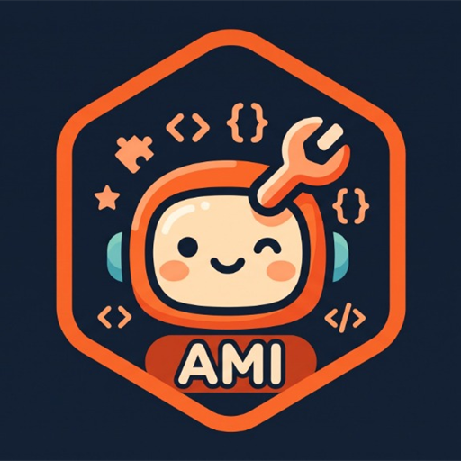
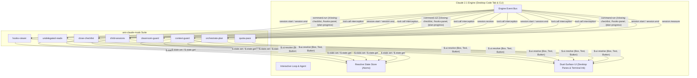

<p align="center">
  
</p>

# AMI Claude Mods

> **Production-grade mods, reactive UI panels, and function hooks for Claude Desktop and Claude Code CLI.**

[English](README.md) | [Español](README.es.md)


---

## Project Overview

`ami-claude-mods` is a curated suite of modular extensions (mods) and function hooks built for the **Claude Desktop** application (integrated Code tab) and the **Claude Code CLI** engine, designed to integrate seamlessly with the **Amiga IA** agent ecosystem (`amiga-ia`). As autonomous AI coding agents tackle increasingly complex workflows, human developers face operational hurdles: context window bloat from mechanical searches, orphaned background containers or dangling processes, accidental cross-account Git commits, unintended mutations on production Kubernetes clusters, and lack of visibility into loaded hooks.

While widely used in terminal sessions via the CLI, `ami-claude-mods` is designed as a first-class companion for **Claude Desktop**—serving as a primary daily-driver environment where side panes (`Pane`), banners (`AbovePrompt`), status gauges, and toast alerts render as native desktop GUI controls.

This repository provides eight decoupled, privacy-safe, and self-contained plugins designed to enhance reliability, visibility, and safety without modifying Claude core binaries.

---

## Mods Catalog

| Mod | Hook Types | Primary Surface | Description |
| :--- | :--- | :--- | :--- |
| **[`hooks-viewer`](mods/hooks-viewer)** | `session.start`, `command.run`, `ui.render` | Side Pane (`Pane`) | Interactive inspector panel and `/hooks-panel` command listing all configured hooks and active plugins across settings layers. |
| **[`undelegated-reads`](mods/undelegated-reads)** | `tool.call`, `prompt.submit`, `ui.render` | Status Bar & `AbovePrompt` | Real-time gauge and circuit breaker that counts mechanical searches and enforces subagent exploration delegation. |
| **[`close-checklist`](mods/close-checklist)** | `tool.call`, `session.end`, `command.run` | Side Pane & Toast | Pre-exit safety inspector tracking uncommitted Git status, active Docker containers/volumes, and lingering tasks via `/closing-checklist`. |
| **[`child-sessions`](mods/child-sessions)** | `session.receive`, `tool.call`, `ui.render` | Above Prompt Banner | Inter-agent messaging inbox that prioritizes blocking questions and provides quick action buttons to reply, view, or dismiss. |
| **[`cleanroom-guard`](mods/cleanroom-guard)** | `tool.call` | Toast & Circuit Breaker | Strict Double-Blind Cleanroom isolation for TDD subagents, preventing test data leakage and confirmation bias. |
| **[`context-guard`](mods/context-guard)** | `tool.call`, `session.start`, `ui.render` | Status Bar & `AbovePrompt` | Multi-profile guard that aligns active GitHub CLI accounts with target workspaces and forbids bare `kubectl` on production clusters. |
| **[`orchestrate-plan`](mods/orchestrate-plan)** | `tool.call`, `command.run`, `ui.render` | Side Pane, Status Bar & Toast | Live progress pane for an orchestrator's `plan.md` (`/plan-progress`), plus the skill that keeps the plan in the contract the pane reads and launches executor sessions. |
| **[`quota-pace`](mods/quota-pace)** | `session.start`, `session.measure` | Status Bar & Toast | Paces the weekly usage limit across your workdays (20% per day on Mon–Fri by default) and warns once a day when usage passes today's target. |

---

## Architecture Overview

All plugins adhere to the isolated ECMAScript Module (ESM) runtime shared across both **Claude Desktop** and **Claude Code CLI**. Rather than importing Node.js internal modules directly, mods communicate with the host environment exclusively through the `EngineInterface` (`$`), allowing reactive state and UI to render seamlessly in both desktop GUI panels and terminal emulators.



### Component Responsibility Matrix

| Mod | Intercepted Engine Events | Engine Invariants Preserved |
| :--- | :--- | :--- |
| `hooks-viewer` | `session.start`, `command.run` | Reads settings immutably; does not mutate hook execution. |
| `undelegated-reads` | `tool.call` (`Read`, `Grep`, `Glob`, shell) | Preserves main context window; subagent calls pass unrestricted. |
| `close-checklist` | `tool.call` (`Write`, `Edit`, shell, Docker, worktrees) | Best-effort resource accounting; never halts runtime tools. |
| `child-sessions` | `session.receive`, `tool.call` (`SendMessage`) | Preserves envelope headers; drops unaddressable message targets. |
| `cleanroom-guard` | `tool.call` (`Read`, `Write`, `Edit`, `Bash`, `PowerShell`) | Subagents restricted to contractual boundaries; main loop unaffected. |
| `context-guard` | `tool.call` (`kubectl`, `git`), `session.start` | Prevents cluster-wide mutations by requiring explicit `--context`. |
| `orchestrate-plan` | `tool.call`, `command.run`, `ui.render` | Reconciles `plan.md` tasks against live sessions and merged PRs without mutating the file. |
| `quota-pace` | `session.start`, `session.measure` | Calculates workday pacing against the 7-day rate limit window without network calls. |

---

## Tech Stack

- **Runtime:** Claude Desktop & Claude Code CLI (Early Access 2.1.x+)
- **Language:** TypeScript 5.4+ (ESNext, Bundler resolution)
- **UI Toolkit:** Dual-surface UI (`Pane`, `AbovePrompt`, `StatusBar`, `Toast`) resolved via `$.ui.resolve`
- **State Management:** Reactive atoms (`atom`, `read`, `update` from `'claude-code'`)
- **Testing Framework:** `'claude-code/testing'` runner (`claude plugin test`)

---

## Getting Started

### Prerequisites

- **Claude Desktop** application (with Code tab enabled) or **Claude Code CLI** (`claude --version` >= 2.1.314)
- Node.js 22+ (for development, installation scripts, and testing)
- Git 2.40+

### Installation & Setup

You can configure mods to load automatically into **Claude Desktop**, persist them across all terminal sessions, run them ad-hoc via CLI flags, or install pre-packaged bundles directly from GitHub Releases.

#### Method 1: Claude Desktop Setup (Primary GUI Workflow)

Claude Desktop loads plugins declaratively from your global configuration file:

1. **Synchronize mods to your local Claude directory:**
   ```bash
   npm run install-mods
   ```
   This copies all eight mods into `~/.claude/mods/`.

2. **Configure persistence in `~/.claude/settings.json`:**
   Add the `CLAUDE_CODE_PLUGIN_DIRS` setting to your global settings:
   ```json
   {
     "CLAUDE_CODE_PLUGIN_DIRS": "~/.claude/mods/child-sessions:~/.claude/mods/cleanroom-guard:~/.claude/mods/close-checklist:~/.claude/mods/context-guard:~/.claude/mods/hooks-viewer:~/.claude/mods/orchestrate-plan:~/.claude/mods/quota-pace:~/.claude/mods/undelegated-reads"
   }
   ```
   *(On Windows, use semicolons `;` as the path delimiter, e.g. `C:/path/to/.claude/mods/...`)*.

3. **Open Claude Desktop:** Switch to the **Code** tab. All mods load automatically with native sidebar panes, banners, and status gauges.

#### Method 2: Persistent CLI Setup (Terminal Workflow)

- **Option A (Global Settings):** If you completed Method 1, Claude Code CLI automatically detects the same `~/.claude/settings.json` and loads the mods in every terminal session.
- **Option B (Shell Profile):** Export the variable directly in your shell profile (`~/.bashrc`, `~/.zshrc`, or `$PROFILE` in PowerShell):
  ```bash
  npm run install-mods -- --print-env
  ```
  Paste the printed export instruction into your shell profile.

#### Method 3: Direct Command-Line Flag (Fast Testing in CLI)

Load one or more mods directly when starting a specific CLI session:

```bash
claude --plugin-dir mods/hooks-viewer --plugin-dir mods/undelegated-reads
```

#### Method 4: Direct Download from GitHub Releases (No Node.js Required)

1. Download the pre-packaged zip bundle from [GitHub Releases](https://github.com/AnaCataVC/ami-claude-mods/releases) (e.g. `ami-claude-mods-all-vX.Y.Z.zip` or individual mod archives).
2. Extract the archive into your preferred directory (e.g. `~/.claude/mods/`).
3. Add the extracted directory to `~/.claude/settings.json` (for Desktop & CLI) or launch Claude Code with `--plugin-dir`:
   ```bash
   claude --plugin-dir ~/.claude/mods/hooks-viewer
   ```

### Display Language

Every mod shows its panes, toasts, status lines and command descriptions in English by default. To switch them to Spanish, set `CLAUDE_MODS_LANG` in the `env` block of your Claude Code `settings.json`:

```json
{
  "env": {
    "CLAUDE_MODS_LANG": "es"
  }
}
```

Only the exact value `es` (case and surrounding spaces ignored) selects Spanish; anything else, including an unset variable, falls back to English. The setting is read when a session starts. It does not change:

- slash command names (`/closing-checklist`, `/hooks-panel`, `/plan-progress`);
- text addressed to the model, such as block reasons;
- the keywords `orchestrate-plan` parses from `plan.md` (`Estado`, `pendiente`, `hecho`...). In English the pane translates the status words it displays, but the file keeps the Spanish keywords.
### Verifying Loaded Mods

Once Claude Desktop or Claude Code starts, confirm that your mods are active:

1. Run `/hooks-panel` to open the interactive **`hooks-viewer`** side pane listing all active plugins, hooks, and settings layers.
2. Run `/closing-checklist` to trigger **`close-checklist`** and inspect uncommitted Git changes, Docker containers, and background tasks before finishing your work.
3. Check status indicators: **`undelegated-reads`** and **`context-guard`** display real-time read gauges and active environment profiles.

### Validating Mods

Validate plugin manifests (`plugin.json`), hooks contracts (`hooks.json`), and atomic state schemas across the suite:

```bash
# Validate all mods across the repository
npm run validate

# Or validate an individual mod
claude plugin validate mods/hooks-viewer
```

---

## Automated Testing & Quality Gates

All mods include automated test suites powered by the `'claude-code/testing'` headless mock engine:

```bash
# Run all mod test suites in sequence
npm test

# Run tests for a specific mod
claude plugin test mods/hooks-viewer
```

Before pushing changes, you can activate local Git pre-push hooks:
```bash
npm run prepare
```

> [!NOTE]
> Verification passes when all automated test suites complete with 100% success and zero regressions.

For a full breakdown of the CI/CD pipelines, release packaging, and Git hooks, see [docs/automations.md](docs/automations.md). For General Availability readiness gates and contract freezing specifications, see [docs/v1-milestone-criteria.md](docs/v1-milestone-criteria.md).

---

## Key Learnings & Architectural Decisions

For an in-depth breakdown of technical constraints, engine bugs prevented, and packaging rules, see the dedicated knowledge base in [docs/learning/](docs/learning/).

1. **Host-Gated Isolation over Node.js Runtime:** Claude Code plugins do not run inside an unconstrained Node.js process. They operate in an isolated ESM container without `require()` or arbitrary `fs` access. All I/O flows through the `$` engine handle (`$.fs`, `$.process`, `$.settings`), guaranteeing sandboxed safety and uniform cross-platform behavior across Windows, macOS, and Linux.
2. **Top-Level Function Scope for Engine Reference (`$`):** Static analysis in the plugin validator strictly enforces that the engine parameter `$` cannot be passed to nested lambdas or functions declared inside the `register` hook closure. Helper functions requiring `$` must be declared as top-level module functions (`async function helper($: Engine) { ... }`).
3. **Double-Blind Cleanroom Synergy:** Automated TDD with AI agents suffers from confirmation bias when test writers inspect source implementations. By implementing `cleanroom-guard`, we decouple the builder (`ami-cleanroom-builder`) and the test author (`ami-cleanroom-tester`), enabling seamless integration with the `ami-orchestrate-cleanroom` skill from Amiga IA.
4. **Declarative State Registration in TypeScript Declarations:** Any atomic key managed by a plugin (`atom({ plugin, key })`) must be formally declared in `types/index.d.ts` extending `interface PluginState`. Failure to declare state keys triggers compilation and validation rejection, preventing untyped state collisions across active plugins.
5. **Configurable Profile Guards for Multi-Tenant Workstations:** Hardcoding account usernames or directory paths destroys open-source portability. By abstracting `context-guard` into a declarative JSON schema (`context-guard.json`), developers can map custom corporate and personal folders, prevent bare `kubectl` mutations, and prevent accidental Git commits across distinct GitHub profiles.
6. **Dual Host Environment Parity (Desktop GUI & CLI Terminal):** The Claude engine resolves UI elements through `$.ui.resolve` to allow plugins to run identically in both Claude Desktop and the terminal CLI. In Claude Desktop, panels like `hooks-viewer` render as interactive side drawers while status metrics and banners anchor directly above the prompt and status footer. Configuration persistence is centralized via `~/.claude/settings.json`, ensuring both desktop and terminal sessions share active mods automatically.

---

## License

This project is licensed under the MIT License. See [LICENSE](LICENSE) for details.
