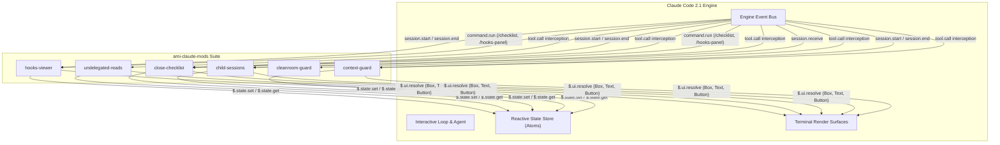

<p align="center">
  
</p>

# AMI Claude Mods

> **Production-grade mods, reactive UI panels, and function hooks for Claude Code CLI.**

[English](README.md) | [Español](README.es.md)


---

## Project Overview

`ami-claude-mods` is a curated suite of modular extensions (mods) and function hooks built for the **Claude Code CLI** engine, designed to integrate seamlessly with the **Amiga IA** agent ecosystem (`amiga-ia`). As autonomous AI coding agents tackle increasingly complex workflows, human developers face operational hurdles: context window bloat from mechanical searches, orphaned background containers or dangling processes, accidental cross-account Git commits, unintended mutations on production Kubernetes clusters, and lack of visibility into loaded hooks.

This repository provides six decoupled, privacy-safe, and self-contained plugins designed to enhance reliability, visibility, and safety without modifying Claude Code core binaries.

---

## Mods Catalog

| Mod | Hook Types | Primary Surface | Description |
| :--- | :--- | :--- | :--- |
| **[`hooks-viewer`](mods/hooks-viewer)** | `session.start`, `command.run`, `ui.render` | Side Pane (`Pane`) | Interactive inspector panel and `/hooks-panel` command listing all configured hooks and active plugins across settings layers. |
| **[`undelegated-reads`](mods/undelegated-reads)** | `tool.call`, `prompt.submit`, `ui.render` | Status Bar & `AbovePrompt` | Real-time gauge and circuit breaker that counts mechanical searches and enforces subagent exploration delegation. |
| **[`close-checklist`](mods/close-checklist)** | `tool.call`, `session.end`, `command.run` | Side Pane & Toast | Pre-exit safety inspector tracking uncommitted Git status, active Docker containers/volumes, and lingering tasks via `/checklist`. |
| **[`child-sessions`](mods/child-sessions)** | `session.receive`, `tool.call`, `ui.render` | Above Prompt Banner | Inter-agent messaging inbox that prioritizes blocking questions and provides quick action buttons to reply, view, or dismiss. |
| **[`cleanroom-guard`](mods/cleanroom-guard)** | `tool.call` | Toast & Circuit Breaker | Strict Double-Blind Cleanroom isolation for TDD subagents, preventing test data leakage and confirmation bias. |
| **[`context-guard`](mods/context-guard)** | `tool.call`, `session.start`, `ui.render` | Status Bar & `AbovePrompt` | Multi-profile guard that aligns active GitHub CLI accounts with target workspaces and forbids bare `kubectl` on production clusters. |

---

## Architecture Overview

All plugins adhere to Claude Code's Isolated ECMAScript Module (ESM) runtime. Rather than importing Node.js internal modules directly, mods communicate with the host environment exclusively through the `EngineInterface` (`$`).



### Component Responsibility Matrix

| Mod | Intercepted Engine Events | Engine Invariants Preserved |
| :--- | :--- | :--- |
| `hooks-viewer` | `session.start`, `command.run` | Reads settings immutably; does not mutate hook execution. |
| `undelegated-reads` | `tool.call` (`Read`, `Grep`, `Glob`, shell) | Preserves main context window; subagent calls pass unrestricted. |
| `close-checklist` | `tool.call` (`Write`, `Edit`, shell, Docker, worktrees) | Best-effort resource accounting; never halts runtime tools. |
| `child-sessions` | `session.receive`, `tool.call` (`SendMessage`) | Preserves envelope headers; drops unaddressable message targets. |
| `cleanroom-guard` | `tool.call` (`Read`, `Write`, `Edit`, `Bash`, `PowerShell`) | Subagents restricted to contractual boundaries; main loop unaffected. |
| `context-guard` | `tool.call` (`kubectl`, `git`), `session.start` | Prevents cluster-wide mutations by requiring explicit `--context`. |

---

## Tech Stack

- **Runtime:** Claude Code CLI (Early Access 2.1.x)
- **Language:** TypeScript 5.4+ (ESNext, Bundler resolution)
- **UI Toolkit:** Native Terminal React/Ink JSX (`h`, `Fragment` globals resolved via `$.ui.resolve`)
- **State Management:** Reactive atoms (`atom`, `read`, `update` from `'claude-code'`)
- **Testing Framework:** `'claude-code/testing'` runner (`claude plugin test`)

---

## Getting Started

### Prerequisites

- Claude Code CLI installed (`claude --version` >= 2.1.314)
- Node.js 22+ (mandated by Claude Code CLI)
- Git 2.40+

### Installation

You can load mods directly using the `--plugin-dir` flag, through the `CLAUDE_CODE_PLUGIN_DIRS` environment variable, or by copying specific plugins into your Claude configuration folder (`~/.claude/mods`).

#### Method A: Direct Command-Line Flag (Fastest)

```bash
claude --plugin-dir mods/hooks-viewer --plugin-dir mods/undelegated-reads
```

#### Method B: Load via Environment Variable

In PowerShell:
```powershell
$env:CLAUDE_CODE_PLUGIN_DIRS = "C:/path/to/ami-claude-mods/mods/hooks-viewer;C:/path/to/ami-claude-mods/mods/undelegated-reads"
claude
```

In Bash:
```bash
export CLAUDE_CODE_PLUGIN_DIRS="/path/to/ami-claude-mods/mods/hooks-viewer:/path/to/ami-claude-mods/mods/undelegated-reads"
claude
```

#### Method C: Automated Sync to Local Plugin Directory

```bash
# Synchronize all mods into ~/.claude/mods/
npm run install-mods

# Or print the exact environment variable declaration for your shell:
npm run install-mods -- --print-env
```

### Validating Mods

Validate plugin manifests (`plugin.json`), hooks contracts (`hooks.json`), and atomic state schemas across the suite:

```bash
# Validate all mods across the repository
npm run validate

# Or validate an individual mod
claude plugin validate mods/hooks-viewer
```

---

## Automated Testing & Quality Gates

All mods include automated test suites powered by the `'claude-code/testing'` headless mock engine:

```bash
# Run all mod test suites in sequence
npm test

# Run tests for a specific mod
claude plugin test mods/hooks-viewer
```

Before pushing changes, you can activate local Git pre-push hooks:
```bash
npm run prepare
```

> [!NOTE]
> Verification passes when all automated test suites complete with 100% success and zero regressions.

For a full breakdown of the CI/CD pipelines, release packaging, and Git hooks, see [docs/automations.md](docs/automations.md).

---

## Key Learnings & Architectural Decisions

For an in-depth breakdown of technical constraints, engine bugs prevented, and packaging rules, see [docs/learnings.md](docs/learnings.md).

1. **Host-Gated Isolation over Node.js Runtime:** Claude Code plugins do not run inside an unconstrained Node.js process. They operate in an isolated ESM container without `require()` or arbitrary `fs` access. All I/O flows through the `$` engine handle (`$.fs`, `$.process`, `$.settings`), guaranteeing sandboxed safety and uniform cross-platform behavior across Windows, macOS, and Linux.
2. **Top-Level Function Scope for Engine Reference (`$`):** Static analysis in the plugin validator strictly enforces that the engine parameter `$` cannot be passed to nested lambdas or functions declared inside the `register` hook closure. Helper functions requiring `$` must be declared as top-level module functions (`async function helper($: Engine) { ... }`).
3. **Double-Blind Cleanroom Synergy:** Automated TDD with AI agents suffers from confirmation bias when test writers inspect source implementations. By implementing `cleanroom-guard`, we decouple the builder (`ami-cleanroom-builder`) and the test author (`ami-cleanroom-tester`), enabling seamless integration with the `ami-orchestrate-cleanroom` skill from Amiga IA.
4. **Declarative State Registration in TypeScript Declarations:** Any atomic key managed by a plugin (`atom({ plugin, key })`) must be formally declared in `types/index.d.ts` extending `interface PluginState`. Failure to declare state keys triggers compilation and validation rejection, preventing untyped state collisions across active plugins.
5. **Configurable Profile Guards for Multi-Tenant Workstations:** Hardcoding account usernames or directory paths destroys open-source portability. By abstracting `context-guard` into a declarative JSON schema (`context-guard.json`), developers can map custom corporate and personal folders, prevent bare `kubectl` mutations, and prevent accidental Git commits across distinct GitHub profiles.

---

## License

This project is licensed under the MIT License. See [LICENSE](LICENSE) for details.
