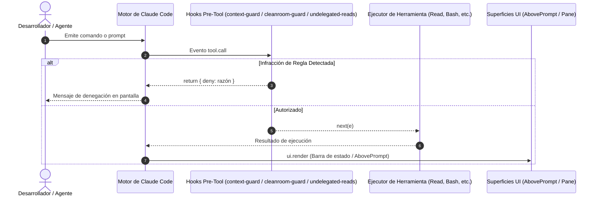

# Arquitectura y Especificaciones de Diseño

[English](architecture.md) | [Español](architecture.es.md)

Referencia técnica integral de `ami-claude-mods`, detallando el modelo de integración, ciclo de vida de los hooks, persistencia reactiva de estado, entornos anfitriones duales (Claude Desktop y Claude Code CLI) y paradigmas de prueba.

---

## 1. Sandbox de Ejecución y Modelo de Aislamiento

Los mods de Claude operan dentro de un entorno de módulos ECMAScript gestionado directamente por el motor, dando vida tanto a **Claude Desktop** (pestaña integrada de Code) como a **Claude Code CLI** con total paridad funcional y contractual.

### Entornos Anfitriones y Paridad de Superficie
- **Claude Desktop:** Actúa como la estación de trabajo visual principal. Los paneles laterales (`Pane`) se despliegan como barras interactivas de escritorio, `AbovePrompt` se ancla sobre la caja de entrada de texto/código, y `$.ui.status` se refleja en la barra inferior persistente de estado.
- **Claude Code CLI:** Orientado a entornos de terminal. Los componentes se resuelven en elementos terminales React/Ink, integrando paneles y barras directamente en los flujos de la consola.

### Restricciones e Invariantes
- **Sin APIs Directas de Node.js:** Los plugins no pueden importar `node:fs`, `node:child_process` o `node:path`. Toda interacción con el sistema se realiza mediante `$.fs` y `$.process`.
- **Módulos ES de Nivel Superior:** Cada archivo de hooks debe ser un módulo ES. Las importaciones dinámicas (`import()`) y `require()` están prohibidas.
- **Ciclo de Vida de la Referencia del Motor (`$`):** La referencia al motor entregada en los manejadores de eventos representa el contexto activo. Para cumplir con la validación estática, las funciones auxiliares que reciban `$` deben declararse en el alcance superior del módulo.

---

## 2. Matriz de Intercepción de Eventos

El siguiente diagrama ilustra el flujo de intercepción de herramientas en la suite:



---

## 3. Persistencia Reactiva de Estado

El estado persistente entre turnos se declara mediante átomos:

```typescript
import { atom, read, update } from 'claude-code'

const countAtom = atom({ plugin: 'undelegated-reads', key: 'count' } as const, 0)
```

Cada clave atómica debe tiparse extendiendo la interfaz `PluginState` en `types/index.d.ts`:

```typescript
declare module 'claude-code' {
  interface PluginState {
    'undelegated-reads': { count: number }
  }
}
```

---

## 4. Protocolo Cleanroom Doble Ciego

En el desarrollo guiado por pruebas (TDD), el aislamiento de información entre el implementador y el autor de pruebas es fundamental para evitar el sesgo de confirmación.

`cleanroom-guard` conecta los subagentes de Claude Code con la skill `ami-orchestrate-cleanroom` de Amiga IA:

1. **Límite del Implementador:**
   - Rol: `ami-cleanroom-builder` o `code-implementer-jr`.
   - Bloqueado: Cualquier lectura, búsqueda o edición sobre rutas de pruebas (`tests/`, `__tests__/`, `*.test.*`, `*_test.*`, `spec/`).
2. **Límite del Autor de Pruebas:**
   - Rol: `ami-cleanroom-tester` o `test-writer-jr`.
   - Bloqueado: Lectura de diffs del working tree sin commitear (`git diff`) o código de producción (`.py`, `.ts`, `.go`, etc.).
   - Permitido: Redacción de pruebas y lectura de versiones base commiteadas mediante `git show HEAD:<path>`.

---

## 5. Especificaciones Técnicas Relacionadas

- **Automatizaciones y Pipelines de CI/CD:** Consulta la [Referencia de Automatizaciones y Flujos de Trabajo](automations.es.md) para detalles sobre hooks pre-push, pruebas en matriz multi-SO y empaquetado de releases.
- **Invariantes y Aprendizajes Arquitectónicos:** Consulta [Aprendizajes Clave e Invariantes Arquitectónicos](learning/README.es.md) para guías individuales de patrones, restricciones del motor y lecciones de runtime.
- **Criterios para el Hito v1.0:** Consulta [Criterios para el Hito de Versión 1.0](v1-milestone-criteria.md) para requisitos, congelación de contratos y puertas de calidad hacia la Disponibilidad General.

