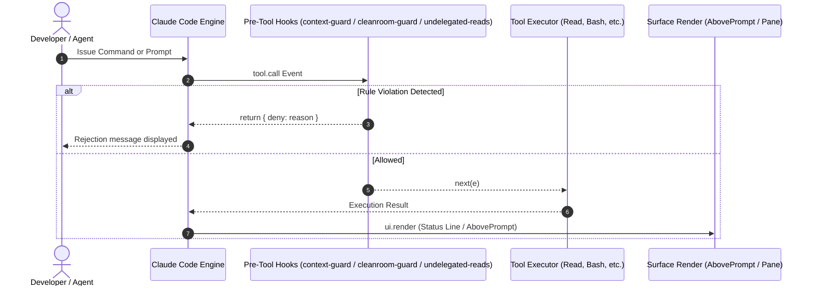

# Architecture & Design Specifications

[English](architecture.md) | [Español](architecture.es.md)

Comprehensive technical reference for `ami-claude-mods`, explaining the integration model, lifecycle hooks, state persistence, dual-surface host environments (Claude Desktop & Claude Code CLI), and testing paradigms.

---

## 1. Execution Sandbox & Isolation Model

Claude mods run in an ECMAScript module runtime hosted directly by the engine, powering both **Claude Desktop** (integrated Code tab) and **Claude Code CLI** with complete feature and contract parity.

### Host Environments & Surface Parity
- **Claude Desktop:** Serves as the primary visual workstation. Side panels (`Pane`) render as interactive desktop sidebars, `AbovePrompt` anchors cleanly above the text/code input field, and `$.ui.status` reflects in the persistent bottom status bar.
- **Claude Code CLI:** Serves terminal developers. Components resolve into React/Ink terminal elements, with panes and status rows rendered directly in terminal output streams.

### Constraints & Invariants
- **No Direct Node.js APIs:** Plugins cannot import `node:fs`, `node:child_process`, or `node:path`. All filesystem and process calls are executed via `$.fs` and `$.process`.
- **Top-Level ES Modules:** Every hook file must be an ES module. Dynamic imports (`import()`) and CommonJS `require()` are prohibited.
- **Engine Reference Lifetime (`$`):** The engine reference passed into event handlers represents the active execution context. To satisfy static validation and avoid scope escapes, helper functions accepting `$` must be declared as top-level functions in the module.

---

## 2. Event Interception Matrix

The following table summarizes the engine events intercepted across the plugin suite:



---

## 3. Reactive State Persistence

State that persists across turns within a session is declared using atoms:

```typescript
import { atom, read, update } from 'claude-code'

const countAtom = atom({ plugin: 'undelegated-reads', key: 'count' } as const, 0)
```

Atoms are typed by extending the `PluginState` interface in `types/index.d.ts`:

```typescript
declare module 'claude-code' {
  interface PluginState {
    'undelegated-reads': { count: number }
  }
}
```

---

## 4. Double-Blind Cleanroom Protocol

In Test-Driven Development (TDD), information isolation between implementer and tester is critical.

`cleanroom-guard` bridges Claude Code subagents with `ami-orchestrate-cleanroom` from Amiga IA:

1. **Implementer Boundary:**
   - Role: `ami-cleanroom-builder` or `code-implementer-jr`.
   - Blocked: Any read, search, or edit operation targeting test paths (`tests/`, `__tests__/`, `*.test.*`, `*_test.*`, `spec/`).
2. **Tester Boundary:**
   - Role: `ami-cleanroom-tester` or `test-writer-jr`.
   - Blocked: Reading uncommitted working tree diffs (`git diff`) or production source files (`.py`, `.ts`, `.go`, etc.).
   - Allowed: Writing tests and reading base committed versions via `git show HEAD:<path>`.

---

## 5. Related Technical Specifications

- **Automations & CI/CD Pipelines:** See [Automations & Workflow Reference](automations.md) for pre-push hooks, multi-OS matrix testing, and release packaging.
- **Architectural Learnings & Invariants:** See [Key Learnings & Architectural Invariants](learning/README.md) for individual pattern guides, engine constraints, and runtime lessons.
- **v1.0 Milestone Criteria:** See [Version 1.0 Milestone Criteria](v1-milestone-criteria.md) for requirements, contract freezes, and readiness gates for General Availability.

