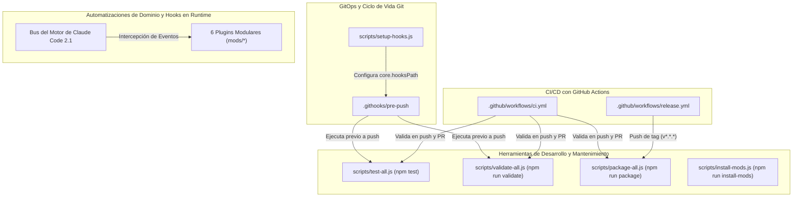

# Referencia de Automatizaciones y Flujos del Repositorio

Guía técnica detallada sobre todos los flujos automatizados de CI/CD, scripts de mantenimiento, hooks de Git e interceptores del motor en tiempo de ejecución configurados en `ami-claude-mods`.

[English](automations.md) | [Español](automations.es.md)

---

## Estructura de Automatizaciones

Las automatizaciones de este repositorio operan a través de tres dominios arquitectónicos interconectados:

---

## 1. Automatizaciones de CI/CD y GitOps

### 1.1. Calidad Continua en Integración (`.github/workflows/ci.yml`)
- **Eventos Disparadores:** Cada `push` a la rama `main` y todos los `pull_request` con destino a `main`.
- **Matriz Multiplataforma:** Ejecución paralela en `ubuntu-latest` y `windows-latest`.
- **Etapas del Pipeline:**
  1. Descarga el código fuente mediante `actions/checkout@v4`.
  2. Inicializa Node.js 22 mediante `actions/setup-node@v4`.
  3. Instala globalmente la CLI de Claude Code (`npm install -g @anthropic-ai/claude-code`).
  4. Valida los manifiestos de todos los plugins (`npm run validate`).
  5. Ejecuta las suites de pruebas automatizadas (`npm test`).
  6. Comprueba la compilación y empaquetado de distribución (`npm run package`).

### 1.2. Publicación Automatizada de Releases (`.github/workflows/release.yml`)
- **Eventos Disparadores:** Envío de etiquetas semánticas con el patrón `v*.*.*`.
- **Permisos:** `contents: write`.
- **Etapas del Pipeline:**
  1. Valida todos los mods y asegura 100% de éxito en las pruebas.
  2. Ejecuta `npm run package` para compilar los archivos `.zip` de cada mod y el paquete unificado `ami-claude-mods-all-v<version>.zip` en la carpeta `releases/`.
  3. Publica un release en GitHub utilizando `softprops/action-gh-release@v2`, adjuntando los archivos `.zip` y generando notas de lanzamiento automáticas.

### 1.3. Guarda Local de Pre-Push (`.githooks/pre-push`)
- **Configuración:** Activado mediante `npm run prepare` (establece `git config core.hooksPath .githooks`).
- **Comportamiento:** Ejecuta `npm run validate` y `npm test` localmente antes de permitir que un comando `git push` se complete. Previene regresiones no deseadas en el repositorio remoto.

---

## 2. Scripts de Desarrollo, Compilación y Mantenimiento

Todos los scripts son módulos multiplataforma de Node.js ubicados en `scripts/` y accesibles a través de comandos `npm run`:

| Comando | Script Subyacente | Descripción |
| :--- | :--- | :--- |
| `npm test` | [`scripts/test-all.js`](../scripts/test-all.js) | Descubre todos los mods en `mods/` y ejecuta `claude plugin test` de forma secuencial. Finaliza con error si alguna prueba falla. |
| `npm run validate` | [`scripts/validate-all.js`](../scripts/validate-all.js) | Ejecuta `claude plugin validate` sobre cada mod verificando el manifiesto (`plugin.json`), hooks (`hooks.json`) y contratos de estado atómico. |
| `npm run package` | [`scripts/package-all.js`](../scripts/package-all.js) | Genera archivos `.zip` independientes para cada plugin y un paquete maestro en `releases/` sin dependencias externas usando `tar` nativo. |
| `npm run install-mods` | [`scripts/install-mods.js`](../scripts/install-mods.js) | Sincroniza todos los mods hacia `$HOME/.claude/mods/` para habilitar la persistencia en Claude Desktop y CLI. Con `--print-env`, imprime la exportación exacta para `CLAUDE_CODE_PLUGIN_DIRS`. |
| `npm run prepare` | [`scripts/setup-hooks.js`](../scripts/setup-hooks.js) | Configura el repositorio Git para activar `.githooks/` como la ruta de hooks locales. |

---

## 3. Automatizaciones de Dominio y Hooks en Runtime (Claude Desktop y CLI)

El repositorio incorpora guardas reactivas, monitores en segundo plano y paneles de interfaz que Claude Desktop y la CLI de Claude Code cargan dinámicamente:

| Mod | Evento Interceptado del Motor | Invariante Automatizado Garantizado |
| :--- | :--- | :--- |
| `undelegated-reads` | `tool.call` (`Read`, `Grep`, `Glob`, shell) | Contabiliza lecturas mecánicas consecutivas y activa un interruptor de corte para forzar la delegación a subagentes de fondo. |
| `cleanroom-guard` | `tool.call` (`Read`, `Write`, `Edit`, shell) | Impone aislamiento Doble Ciego en subagentes TDD, impidiendo que el constructor lea pruebas y que el autor de pruebas lea código de implementación. |
| `context-guard` | `tool.call` (`kubectl`, `git`), `session.start` | Bloquea llamadas accidentales a `kubectl` sin contexto en clústeres de producción y valida la correspondencia de perfiles en GitHub CLI. |
| `close-checklist` | `tool.call`, `session.end`, `command.run` | Contabiliza de manera reactiva cambios pendientes en Git, contenedores Docker y worktrees huérfanos al salir o invocar `/closing-checklist`. |
| `orchestrate-plan` | `tool.call`, `command.run`, `ui.render` | Panel en vivo con el avance del `plan.md` de una sesión orquestadora (`/plan-progress`), más la skill que mantiene el plan en el contrato que lee el panel y lanza las sesiones ejecutoras. |
| `quota-pace` | `session.start`, `session.measure` | Reparte el límite de uso semanal entre días laborales, muestra el progreso diario en la barra de estado y alerta al sobrepasar la cuota del día. |
| `child-sessions` | `session.receive`, `tool.call`, `ui.render` | Intercepta mensajes entre agentes, destaca preguntas bloqueantes sobre el prompt y facilita respuestas interactivas. |
| `hooks-viewer` | `session.start`, `command.run`, `ui.render` | Registra el comando `/hooks-panel` y abre un panel lateral de inspección de todos los hooks y plugins activos. |
