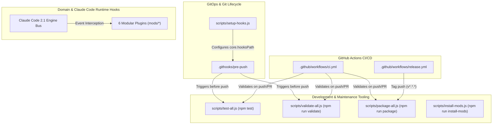

# Repository Automations & Workflow Reference

Comprehensive technical guide detailing all automated pipelines, maintenance scripts, Git hooks, and runtime engine interceptors configured in `ami-claude-mods`.

[English](automations.md) | [Español](automations.es.md)

---

## Architecture Overview

Automations in this repository operate across three interconnected operational domains:

---

## 1. CI/CD & GitOps Automations

### 1.1. Continuous Integration Quality Gate (`.github/workflows/ci.yml`)
- **Trigger Events:** Every `push` to `main` and all `pull_request` targeting `main`.
- **Platform Matrix:** Multi-OS testing across `ubuntu-latest` and `windows-latest`.
- **Execution Pipeline:**
  1. Checks out repository source via `actions/checkout@v4`.
  2. Sets up Node.js 22 environment via `actions/setup-node@v4`.
  3. Installs Claude Code CLI globally (`npm install -g @anthropic-ai/claude-code`).
  4. Runs manifest validation across all mods (`npm run validate`).
  5. Executes automated test suites across all mods (`npm test`).
  6. Verifies distribution packaging compilation (`npm run package`).

### 1.2. Automated Release & Asset Packaging (`.github/workflows/release.yml`)
- **Trigger Events:** Push of semantic release tags matching `v*.*.*`.
- **Permissions:** `contents: write`.
- **Execution Pipeline:**
  1. Validates all mod manifests and runs complete test suites.
  2. Executes `npm run package` to compile individual mod `.zip` archives and the unified bundle `ami-claude-mods-all-v<version>.zip` into `releases/`.
  3. Publishes a official GitHub Release using `softprops/action-gh-release@v2` attaching all generated `.zip` assets and automatically generating release notes.

### 1.3. Local Git Pre-Push Hook (`.githooks/pre-push`)
- **Configuration:** Initialized via `npm run prepare` (which sets `git config core.hooksPath .githooks`).
- **Functionality:** Runs `npm run validate` and `npm test` locally before any `git push` command is allowed to proceed. Prevents accidental regression leaks to remote.

---

## 2. Development, Build & Maintenance Scripts

All scripts are cross-platform Node.js modules located in `scripts/` and invoked through standard `npm run` commands:

| Command | Underlying Script | Description |
| :--- | :--- | :--- |
| `npm test` | [`scripts/test-all.js`](../scripts/test-all.js) | Discovers all mod directories in `mods/` and executes `claude plugin test` sequentially. Fails if any test fails. |
| `npm run validate` | [`scripts/validate-all.js`](../scripts/validate-all.js) | Discovers all mods and runs `claude plugin validate` on each mod manifest (`plugin.json`), hooks schema (`hooks.json`), and atomic state declarations. |
| `npm run package` | [`scripts/package-all.js`](../scripts/package-all.js) | Generates individual `.zip` archives for each mod and a master bundle archive inside the `releases/` folder without external dependencies using native system `tar`. |
| `npm run install-mods` | [`scripts/install-mods.js`](../scripts/install-mods.js) | Copies all mods to `$HOME/.claude/mods/` for Claude Desktop and CLI persistence. With `--print-env`, outputs the exact system environment variable declaration for `CLAUDE_CODE_PLUGIN_DIRS`. |
| `npm run prepare` | [`scripts/setup-hooks.js`](../scripts/setup-hooks.js) | Configures Git repository settings to activate `.githooks/` as the local hooks path. |

---

## 3. Domain & Runtime Automations (Claude Desktop & CLI Hooks)

The repository provides automated runtime guards, background monitors, and reactive panels loaded by Claude Desktop and Claude Code CLI:

| Mod | Intercepted Engine Event | Automated Invariant Enforced |
| :--- | :--- | :--- |
| `undelegated-reads` | `tool.call` (`Read`, `Grep`, `Glob`, shell) | Counts consecutive mechanical file inspections and triggers circuit breaker to delegate exploration to background subagents. |
| `cleanroom-guard` | `tool.call` (`Read`, `Write`, `Edit`, shell) | Enforces double-blind isolation for TDD subagents, blocking builders from reading tests and testers from reading implementation diffs. |
| `context-guard` | `tool.call` (`kubectl`, `git`), `session.start` | Blocks accidental bare `kubectl` mutations on production Kubernetes clusters and verifies GitHub CLI account alignment. |
| `close-checklist` | `tool.call`, `session.end`, `command.run` | Automatically tallies uncommitted Git modifications, running Docker containers, and dangling worktrees upon exit or `/checklist`. |
| `child-sessions` | `session.receive`, `tool.call`, `ui.render` | Intercepts cross-agent messages, surfaces urgent questions above the prompt, and handles reactive replies. |
| `hooks-viewer` | `session.start`, `command.run`, `ui.render` | Automatically registers the `/hooks-panel` command and opens a side pane inspecting loaded hooks and plugin layers. |
