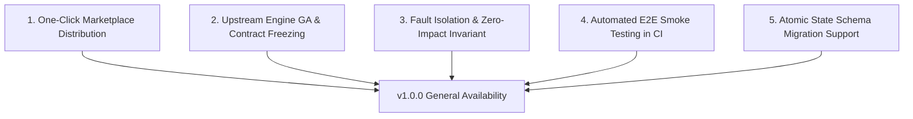

# Version 1.0 (General Availability) Milestone Criteria

This document establishes the formal engineering and operational criteria required for `ami-claude-mods` to transition from the `v0.x` developmental phase to **`v1.0.0` (General Availability & Production-Ready)**.

---

## Strategic Goals for v1.0

While the current `v0.5.x` releases provide production-grade stability, automated testing across three operating systems (Linux, macOS, Windows), and full dual-surface support (Claude Desktop and Claude Code CLI), `v1.0.0` represents a formal guarantee of **contractual immutability, zero-friction distribution, and complete runtime isolation**.



---

## 1. Distribution & Installation: Native Marketplace Support

Currently, users install mods via local cloning and manual `CLAUDE_CODE_PLUGIN_DIRS` configuration or by running `npm run install-mods`.

### Required for v1.0:
- **Root `marketplace.json` Catalog:** Provide an official manifest at repository root defining all 8 mods with metadata, categories, keywords, and release archives.
- **Single-Command Installation:** Enable native installation via Claude Code CLI and Desktop without manual path linking:
  ```bash
  /plugin install <mod-name> --marketplace AnaCataVC/ami-claude-mods
  ```
- **Validated Directory Compliance:** Resolve all validator advisories so that `claude plugin validate` passes with zero warnings and zero installation hints across all plugins.

---

## 2. API Stability & Contract Freezing

In `v0.x`, internal hooks and command names may evolve (e.g., the recent refinement from `/checklist` to `/closing-checklist`). In `v1.0.0`, all public interfaces become strictly immutable under Semantic Versioning (SemVer 2.0.0).

### Required for v1.0:
- **Slash Command Immutability:** Slash command signatures (`/closing-checklist`, `/hooks-panel`, `/plan-progress`) are frozen. Any future rename requires deprecation aliases across at least one minor release cycle.
- **Hook Signatures & Event Contracts:** Event handlers (`session.start`, `session.end`, `session.receive`, `session.measure`, `tool.call`, `command.run`, `ui.render`) conform to a documented versioned interface.
- **Model-Facing Invariance:** Reasons addressed to the model on blocking decisions (e.g., `undelegated-reads`, `cleanroom-guard`, `context-guard`) remain language-independent and deterministic to prevent LLM prompt drifting.

---

## 3. Upstream Engine Maturity (Claude Code Platform)

The host plugin runtime in Claude Desktop and Claude Code CLI is currently in Early Access (`2.1.x`).

### Required for v1.0:
- **Platform GA Alignment:** The Claude Code plugin architecture reaches General Availability (GA) or documented long-term API stability from Anthropic.
- **Type Declaration Stability:** The core types package (`@anthropic-ai/claude-code` or `@claude-code/types`) is released as a stable npm dependency rather than relying on bundled definitions.

---

## 4. Fault Isolation & Zero-Impact Invariants

Mods run in the same ECMAScript process as the Claude engine. An unhandled failure in a mod must never degrade, stall, or crash the host agent loop.

### Required for v1.0:
- **Universal Error Boundaries:** Every gating hook, background process execution (`git`, `docker`, `gh`), and state deserialization has top-level `.catch()` guards with fallback to permissive execution (`next(e)`).
- **Sub-5ms Execution Budget:** Intercepted `tool.call` handlers must complete synchronous evaluation in under 5ms, offloading heavy computations or system inspections to asynchronous detached promises.
- **Graceful Tool Degradation:** If underlying system binaries (`git`, `docker`, `gh`, `kubectl`) are missing or unauthenticated, mods display helpful guidance without raising fatal exceptions.

---

## 5. End-to-End (E2E) Smoke Testing in CI

Existing tests thoroughly validate unit behavior through `claude plugin test` (190+ test cases across 8 mods).

### Required for v1.0:
- **Headless Runtime Smoke Tests:** GitHub Actions CI must launch a headless Claude session with all 8 mods loaded concurrently, verifying that:
  - Startup hooks execute cleanly without warnings.
  - Side panes (`Pane`), status indicators (`$.ui.status`), and above-prompt banners (`AbovePrompt`) mount without UI layout thrashing.
  - Inter-mod atom namespaces remain strictly collision-free.

---

## 6. State Schema Evolution & Migrations

Mods persist lightweight operational data in atomic session state (`$.state.get` / `$.state.set`).

### Required for v1.0:
- **Versioned State Atoms:** Atom schemas include an internal schema version (`v: 1`).
- **Defensive Deserialization:** Corrupted or outdated persisted state from previous versions is automatically reset to default values without manual user intervention.

---

## Verification Checklist for v1.0 Release Gate

| Category | Requirement | Current Status (`v0.5.0`) | v1.0 Gate |
| :--- | :--- | :---: | :---: |
| **Distribution** | Root `marketplace.json` for 1-command install | Manual / `install-mods.js` | ⏳ Pending |
| **Mod Count** | 8 core plugins fully implemented and tested | 8 mods implemented |  Passed |
| **Localization** | Symmetric English / Spanish UI & docs | Full i18n (`CLAUDE_MODS_LANG`) |  Passed |
| **CI Quality** | Multi-OS test matrix (Linux, macOS, Windows) | Automated CI on 3 OSs |  Passed |
| **Contract** | Immutability guarantee on commands & events | Evolutionary (`v0.x`) | ⏳ Pending |
| **Platform** | Upstream Claude Code plugin runtime stability | Early Access (`2.1.x`) | ⏳ Pending |
| **Resilience** | Zero-impact crash isolation across all hooks | Implemented in main hooks | ⏳ Audit required |
